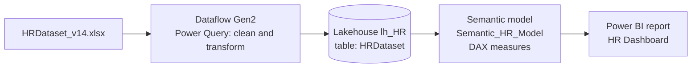

# HR Analytics Dashboard with Microsoft Fabric and Power BI

An end-to-end HR analytics project built in **Microsoft Fabric**. An Excel file of employee data is cleaned with **Dataflow Gen2**, stored in a **Lakehouse**, modelled in a **semantic model** with DAX measures, and shown in an interactive **Power BI** dashboard.

> **Why I built this:** HR data lived in a spreadsheet and was hard to understand quickly. I wanted one dashboard that shows headcount, attrition, salary and hiring trends, so managers can make decisions faster.]

---

## Dashboard preview


---

## Architecture



| Step | Tool | What it does |
|---|---|---|
| 1 | Excel file | Source data: 311 employees, 39 columns |
| 2 | Dataflow Gen2 (`Dataflow_HR`) | Cleans the data and loads it to the lakehouse |
| 3 | Lakehouse (`lh_HR`) | Stores the table `HRDataset` as a Delta table |
| 4 | Semantic model (`Semantic_HR_Model`) | Holds the table and the DAX measures |
| 5 | Power BI report | Interactive HR dashboard |

---

## Tech stack

- Microsoft Fabric (Dataflow Gen2, Lakehouse, Semantic model)
- Power Query (M)
- DAX
- Power BI

---

## Data preparation (Dataflow Gen2)

The dataflow `Dataflow_HR` reads `HRDataset_v14.xlsx` in Power Query and applies these steps:

- Change column data types
- Add an **Age Bracket** column to group employees by age
- Remove columns that are not needed
- Set the **Lakehouse** as the data destination


---

## Lakehouse

The cleaned data is saved in lakehouse `lh_HR` as the table `HRDataset` (311 rows, 39 columns).

Example columns: `Employee_Name`, `EmpID`, `Age`, `Age Bracket`, `Department`, `Position`, `RecruitmentSource`, `MaritalDesc`, `CitizenDesc`, `DateofHire`, `DateofTermination`, `Absences`, `DaysLateLast30`


---

## Semantic model

The semantic model `Semantic_HR_Model` is built on the `HRDataset` table. It holds the business measures, so every report uses the same definitions.

| Measure | Purpose |
|---|---|
| Attrition | Number of employees who left |
| Attrition % | Share of employees who left |
| Average Age | Average age of employees |
| Average Salary | Average salary |
| Cumulative Headcount | Running total of headcount by hire date |


---

## Dashboard

The report has four filters (**Department, Gender, Position, Employee Status**) and these views:

- **Key numbers:** Head Count, Attrition, Attrition %, Average Salary, Average Age
- **Headcount by department**
- **Headcount by age**
- **Headcount by recruitment source**
- **Headcount by gender**
- **Headcount by marital status and gender**
- **Cumulative headcount by date of hire**

### Key numbers (all filters set to "All")

| Metric | Value |
|---|---|
| Head Count | 311 |
| Attrition % | 33.44% |
| Average Salary | 69.02K |
| Average Age | 47.41 |

### What the data shows

- **Production** is by far the largest department. IT/IS and Sales follow.
- **Indeed** (87 hires) and **LinkedIn** (76 hires) are the top recruitment sources, together more than half of all hires.
- **Hiring** grew steadily from around 2010 and levelled off in later years.
- About **1 in 3 employees** has left the company (33.44%).

---

## How to run this project

1. Create a Fabric workspace (a trial works) and a **Lakehouse** (`lh_HR`).
2. Create a **Dataflow Gen2**, connect it to the HR Excel file, apply the cleaning steps, and set the lakehouse as the destination.
3. Run the dataflow to load the `HRDataset` table.
4. Create a **semantic model** from the lakehouse table and add the DAX measures.
5. Build the Power BI report and add the filters and charts.

---

## Project structure

```
hr-analytics-fabric/
├── README.md
└── images/
    ├── 01-dataflow.png
    ├── 02-lakehouse.png
    ├── 03-Semantic-Model.png
    └── 04-HR-DASHBOARD.png
```

---

## Future improvements

- Add attrition by department and by recruitment source
- Add a salary analysis by position
- Add row-level security by department
- Schedule the dataflow to refresh automatically

---

## Author

**LENA SHAJAHAN**
